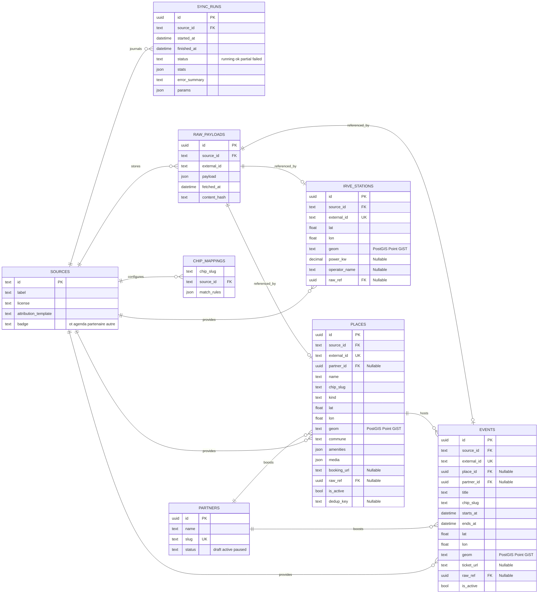
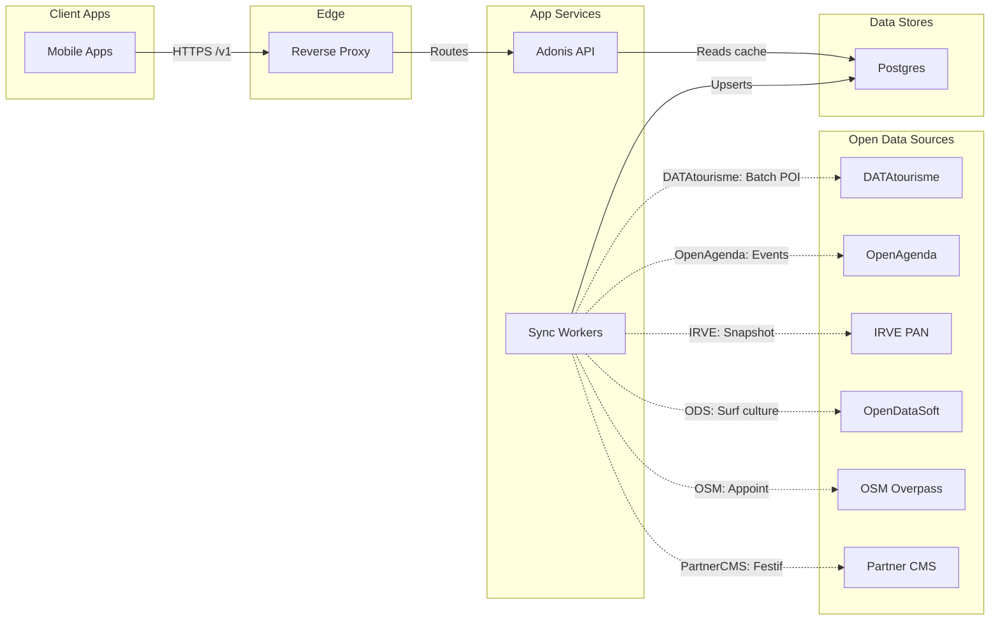
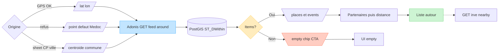

# Médoc Vibes — diagrammes

**Source :** [data-model-sync.md](data-model-sync.md) · parcours : [app-journey-brainstorm.md](app-journey-brainstorm.md)  
**Date :** 2026-10-01 (maj FigJam 2026-10-02 · note PostGIS soir)  
**Statut FigJam :** done — 4 diagrammes générés via Figma MCP `generate_diagram` (plan `anthony.marcelin13's team`).  
**Board :** [Médoc Vibes FigJam](https://www.figma.com/board/JwcGzdNFMIn1MRnA3WLWwa)  
**Note PostGIS (Q3) :** ERD / feed à enrichir — colonnes `geom` (geography Point) + index GiST sur `places` / `events` / `irve_stations` ; chemin feed = `ST_DWithin` serveur (plus bbox + haversine client seul).

| # | Diagramme | Lien |
|---|---|---|
| 1 | Modèle de données (ERD) | [board](https://www.figma.com/board/JwcGzdNFMIn1MRnA3WLWwa) |
| 2 | Architecture sync + API | idem |
| 3 | Pipeline sync nocturne | idem |
| 4 | Chemin feed « autour » | idem |

**Contenu ci-dessous :** sources Mermaid + URLs FigJam.

---

## 1. Modèle de données (erDiagram)

**Ce que ça montre :** tables cœur Postgres — `sources`, `sync_runs`, `partners`, `places`, `events`, `irve_stations`, `raw_payloads`, `chip_mappings` — avec clés et cardinalités (provenance, partner boost, lieu ↔ events, raw payloads).  
**À ajouter (PostGIS) :** `geom` sur `PLACES` / `EVENTS` / `IRVE_STATIONS` (voir [data-model-sync](data-model-sync.md) §2 · [parcours §5](app-journey-brainstorm.md)).

**URL FigJam :** [Médoc Vibes — modèle de données](https://www.figma.com/board/JwcGzdNFMIn1MRnA3WLWwa)

---

## 2. Architecture sync + lecture API

**Ce que ça montre :** apps → reverse proxy → Adonis API → Postgres (cache seul côté requête) ; workers de sync qui upsertent Postgres depuis les sources OD (DATAtourisme, OpenAgenda, IRVE PAN, ODS/Culture/Mérimée, OSM, Partner CMS). Pas d’appel live sources sur le chemin user.

**URL FigJam :** [Médoc Vibes — architecture sync + API](https://www.figma.com/board/JwcGzdNFMIn1MRnA3WLWwa)  
**Paramètre outil :** `useArchitectureLayoutCode: "FIGMA_DIAGRAM_2026"` ✓

---

## 3. Pipeline sync nocturne (flowchart)

**Ce que ça montre :** ordre recommandé des jobs (DT → OA → IRVE → data.culture → Mérimée → ODS → OSM → Partner CMS) vers upsert Postgres idempotent (`source_id` + `external_id`, `content_hash`, soft-delete, `sync_runs`).

**URL FigJam :** [Médoc Vibes — pipeline sync nocturne](https://www.figma.com/board/JwcGzdNFMIn1MRnA3WLWwa)  
**Note :** flowchart générique (pas `useArchitectureLayoutCode`).

```mermaid
flowchart LR
    startNode([Pipeline sync]) --> jobDt[DATAtourisme]
    jobDt -->|"Quotidien nuit"| jobOa[OpenAgenda]
    jobOa -->|"Toutes 2 a 6 h"| jobIrve[IRVE PAN]
    jobIrve -->|"Quotidien"| jobCulture[data.culture]
    jobCulture -->|"Hebdo"| jobMerimee[Merimee]
    jobMerimee -->|"Hebdo mensuel"| jobOds[OpenDataSoft]
    jobOds -->|"Quotidien ou hebdo"| jobOsm[OSM appoint]
    jobOsm -->|"Hebdo"| jobPartner[Partner CMS]
    jobPartner -->|"Temps reel"| upsertStep[Upsert idempotent]
    upsertStep --> pgCache[(Postgres)]
    upsertStep -.-> syncLog[sync_runs]

    style startNode fill:#C2E5FF,stroke:#3DADFF
    style upsertStep fill:#FFECBD,stroke:#FFC943
    style pgCache fill:#CDF4D3,stroke:#66D575
```

---

## 4. Chemin requête feed « autour » (flowchart)

**Ce que ça montre :** origine (GPS **ou** point défaut Médoc **ou** centroïde CP/ville) → `GET /v1/feed/around` → PostGIS `ST_DWithin` → **partenaires d’abord** puis organique distance → liste / empty ; IRVE voisin optionnel.

**URL FigJam :** [Médoc Vibes — chemin feed autour](https://www.figma.com/board/JwcGzdNFMIn1MRnA3WLWwa)  
**Note :** FigJam encore en « bbox + client » — aligner quand on régénère (PostGIS + partenaires-first + fallback Médoc). Parcours client : [app-journey-brainstorm](app-journey-brainstorm.md).

---

## Génération Figma (2026-10-02)

| Étape | Résultat |
|---|---|
| Skill `figma-generate-diagram` + refs | Lus |
| Source `docs/data-model-sync.md` | Lue |
| MCP Figma | Authentifié |
| Plan | `team::1420425458811492409` (anthony.marcelin13's team, Full) |
| `generate_diagram` × 4 | OK — board `JwcGzdNFMIn1MRnA3WLWwa` |
| Architecture | `useArchitectureLayoutCode: "FIGMA_DIAGRAM_2026"` |

**Board :** [https://www.figma.com/board/JwcGzdNFMIn1MRnA3WLWwa](https://www.figma.com/board/JwcGzdNFMIn1MRnA3WLWwa)
